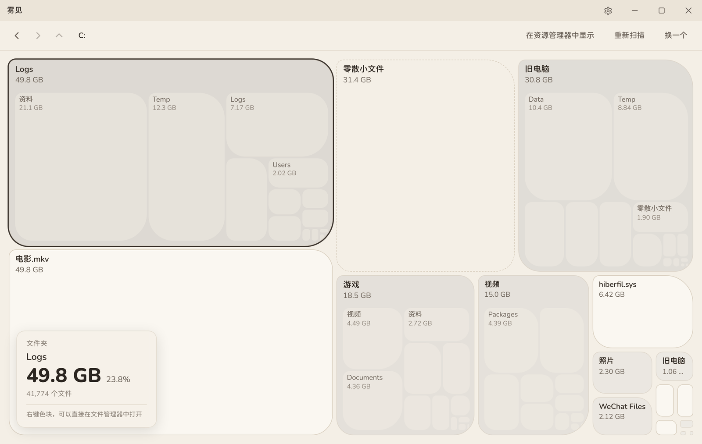
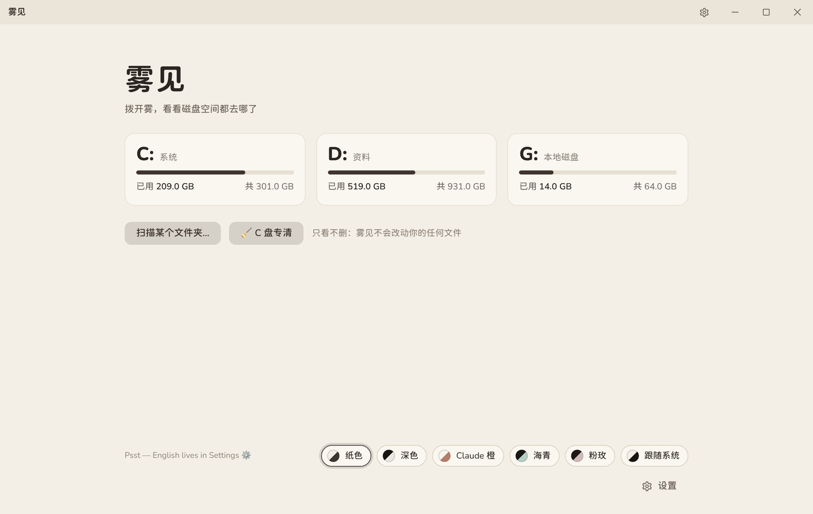
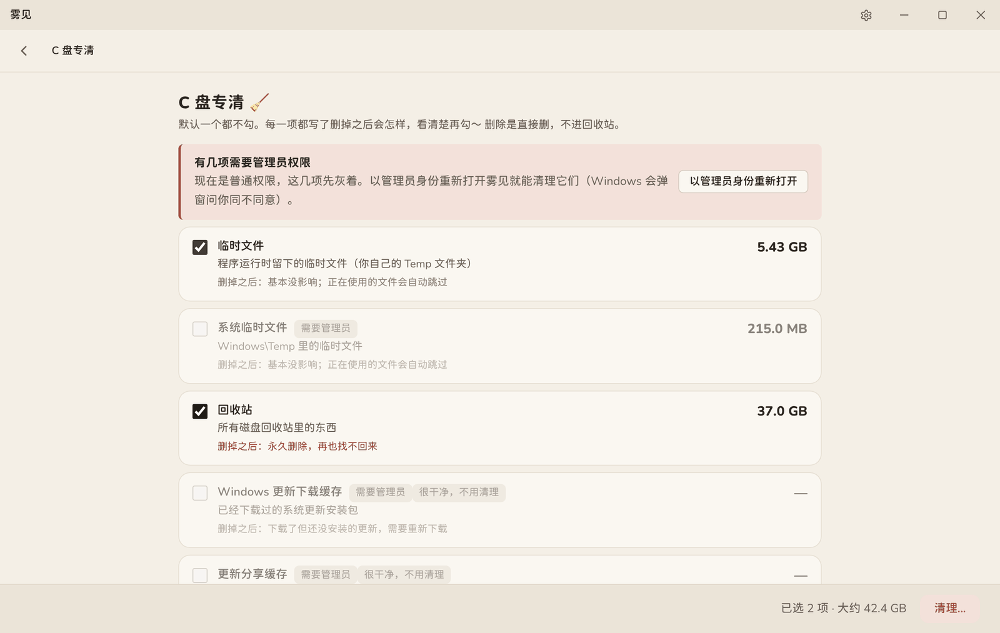
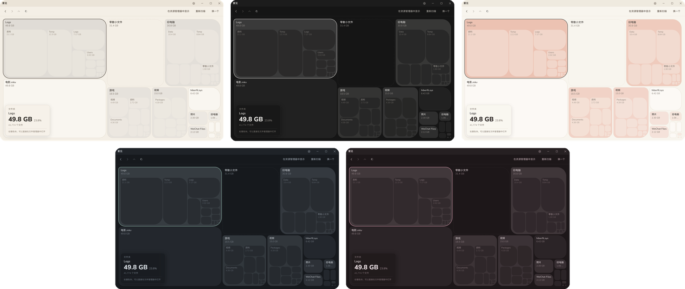

# 雾见

拨开雾，看看磁盘空间都去哪了。

一个 Windows 磁盘空间查看器：扫描整个磁盘或某个文件夹，把每个文件夹按大小铺成一片色块。
色块越大，占的空间越多；点进去继续看。灵感来自 Mac 上的 Kanso。

由 **大雾** 和 **Claude** 一起做的 🧡

**中文 | [English](#english)**



## 特点

- **只看不删**：雾见不会改动、删除、移动你的任何文件。唯一会打开的东西是资源管理器（点“在资源管理器中显示”时）。
- **快**：Rust 写的多线程扫描，所有 CPU 核心一起跑。实测 C 盘 64 万个文件：第一次 4.8 秒，再扫一次 2.1 秒。
  机械硬盘会自动识别，改用 2 个线程顺着读，减少磁头来回跳。
- **便携**：一个 exe，拷到 U 盘上哪台电脑都能直接打开，不用安装。
  （需要系统里有 WebView2，Windows 10/11 一般都自带。）
- **中英双语**：默认跟随系统语言，也可以在“设置 → 外观”里随时切换。
- **五套配色**：纸色、深色、Claude 橙、海青、粉玫，也可以跟随系统。

## 截图

<table>
<tr>
<td width="50%"><br><sub>首页：选一个磁盘，或者扫描某个文件夹</sub></td>
<td width="50%"><br><sub>C 盘专清：每一项都写了删掉之后会怎样</sub></td>
</tr>
</table>


<sub>五套配色：纸色、深色、Claude 橙（上排），海青、粉玫（下排）</sub>

<sub>首页是真实截图，其余截图使用模拟数据。</sub>

## 怎么用

1. 在 Releases 里下载 `FogSight.exe`，双击打开
2. 点一个磁盘，或者“扫描某个文件夹…”
3. 等它扫完，鼠标移到色块上看详情，点文件夹色块进入，按 Backspace 或左上角箭头返回上一层

有些系统文件夹需要管理员权限才能读取，没权限的会跳过，扫完后左下角会显示跳过了几个。
想扫到它们：右键 `雾见.exe` → 以管理员身份运行。

### 几个说明

- 小于 1 MB 的文件不单独画，合成一块“零散小文件”，这样扫几百万个文件也不会占太多内存。
- 快捷方式、符号链接、挂载点不会跟进去，避免重复计算。
- 显示的是文件本身的大小。被压缩的文件、硬链接（比如 `C:\Windows\WinSxS` 里很多）可能让总数和“属性”里看到的不完全一样。

## C 盘专清

首页点“🧹 C 盘专清”，列出 C 盘上几个常见的“垃圾”位置：临时文件、回收站、Windows 更新缓存、浏览器缓存、缩略图缓存、错误报告、休眠文件等，每一项都写了删掉之后会怎样。

- 默认一个都不勾；勾选后还有一个最后确认窗口，点“确认清理”才会删
- 能删的位置全部写死在程序里（`src-tauri/src/clean.rs`），界面只能传项目名，传不进任何路径
- 只删这些文件夹里面的东西；链接不跟进去；正在使用的文件自动跳过
- 删除是直接删，不进回收站
- Windows.old 不直接删，交给 Windows 存储设置清理；休眠文件用系统命令 `powercfg /hibernate off` 关闭
- 下载文件夹、微信和 QQ 的聊天文件只显示大小，不帮你删

## 自己编译

需要：Rust、Node.js、Visual Studio 的 C++ 生成工具。

```bash
npm install
npm run dev      # 开发模式，改了界面会自动刷新
npm run build    # 编译发布版，生成 src-tauri/target/release/wujian.exe
```

界面也可以直接在浏览器里看：用任意本地服务器打开 `src/index.html`，会自动换成模拟数据。

## 文件结构

| 位置 | 是什么 |
|---|---|
| `src/` | 界面（纯 HTML/CSS/JS，不需要构建） |
| `src/设计包/` | 共享设计包的副本（配色、字体、组件） |
| `src/layout.js` | 色块图布局：方形树图 + 不规则圆角 |
| `src/mock.js` | 浏览器里调界面用的模拟数据 |
| `src-tauri/src/scan.rs` | 扫盘核心 |
| `src-tauri/src/main.rs` | 窗口、命令、进度推送 |
| `src-tauri/examples/bench.rs` | 测速：`cargo run --release --example bench -- C:\` |
| `src-tauri/src/clean.rs` | C 盘专清：能删的位置、删除规则 |
| `src-tauri/src/win.rs` | 直接调用的 Windows 接口：机械盘识别、管理员、回收站 |
| `src-tauri/examples/` | 测速、专清统计（只读）、删除安全测试 |
| `tools/生成图标.py` | 画程序图标 |

## 授权

- 代码：MIT
- 字体：Nunito 和 975 圆体，都是 SIL OFL 1.1（见 `src/设计包/字体/` 里的两个 OFL 文件）

---

<a id="english"></a>

## English

**FogSight (雾见)** — clear the fog, see where your disk space went.

A disk space visualizer for Windows. It scans a whole drive or a single folder and lays out every folder as a block sized by how much space it takes. Click a block to dive in. Inspired by Kanso on the Mac.

Made by **大雾** and **Claude** 🧡


<sub>Screenshots show the Chinese interface with demo data; switch to English in Settings → Appearance. More screenshots are in the Chinese section above.</sub>

- **Look, don't touch**: browsing never changes, deletes or moves any of your files.
- **Fast**: multi-threaded Rust scanner. Drive C with 640,000 files: 4.8 s on the first scan, 2.1 s on a rescan. Hard disk drives are detected automatically and read in order with 2 threads.
- **Portable**: a single exe that runs from a USB stick on any PC, no install needed (requires WebView2, which Windows 10/11 usually ship with).
- **Chinese and English**: follows your system language; switch anytime in Settings → Appearance.
- **Five color themes**: Paper, Dark, Claude Orange, Sea Glass and Rose, or follow the system.
- **C: Drive Cleanup**: lists common junk locations on drive C and explains what happens if each is deleted. Nothing is checked by default, and nothing is deleted until you confirm.

### How to use

1. Double-click `FogSight.exe` (download it from Releases)
2. Pick a drive, or “Scan a folder…”
3. Hover over a block to see its details, click a folder block to open it, and press Backspace or the arrow in the top-left to go back

Some system folders can only be read with administrator rights and are skipped. To include them, right-click the exe → Run as administrator.

### Build it yourself

You need Rust, Node.js and the Visual Studio C++ build tools. See the commands in the Chinese section above.

License: MIT · Fonts: Nunito, 975 Yuan (SIL OFL 1.1)

